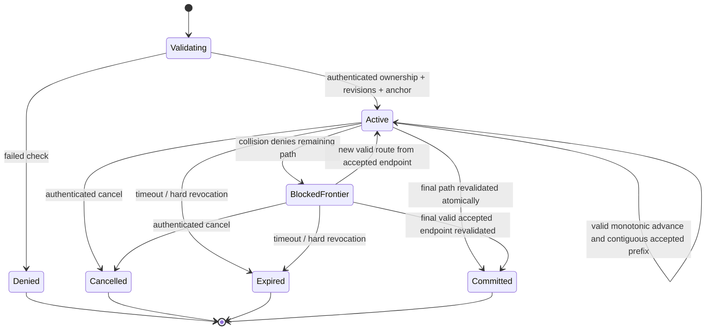
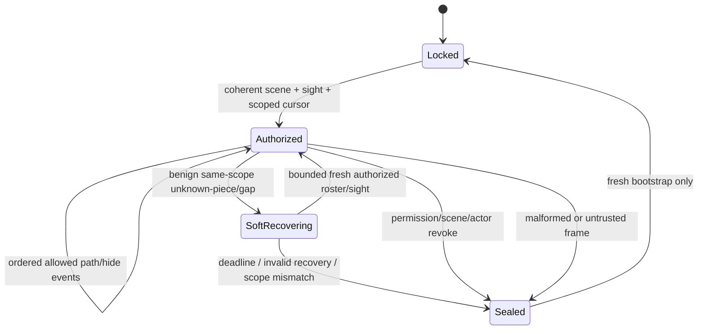

# B01 — World Engine V2 movement authority and security contract

**Status:** Design frozen for B02 evaluation; **not implemented**, **not approved for release**.  
**Recorded:** 10 November 2026.  
**Source baseline:** `main@b246b3a72537b53b2afc2a9a38cbe1db3609a8af`; staged ancestry PR #72 → #73 → #74 → #75.  
**Governance exception:** The designer delegated free-tier engineering decisions on 10 November. As lead developer I authorize **B01 design-only work ahead of A06/Gate A completion**, because waiting for unavailable authenticated browser sessions does not improve the safety of a non-executable specification. **A06 remains BLOCKED; Gate A remains NOT PASSED**. This exception does **not** authorize merging PR #71, production deployment, database writes, paid services, live campaign changes, or representing unexecuted acceptance tests as passed. A06/Gate A must be satisfied before a gameplay release; any broader sequencing exception must be separately recorded.

## 1. Evidence and compatibility baseline

Source-verified on current `main`:
- `src/engine/v2/MovementController.js` and `AuthorityClient.js`: one async begin, sequential server-approved advance batches, then final commit; a local single gesture/sequence and serialized drain. The controller rejects mismatched accepted prefixes and cancels stale gestures; current commits wait for all pending advances.
- `GesturePath.js`: bounded route expansion, up to 8 targets and 24 expanded cells per batch. Server `20261109095000_world_engine_v2_motion_authority.sql`: authenticated DM/player map/ownership checks; 1–48 unique selected token/tool actors; per-session actor/scene/permission/rules checks; 64 batches, 128 attempted cells, 10-second sliding expiry and 60-second absolute lifetime; group offsets; swept collision and footprint checks; final transaction revalidation, sorted row locks and checkpoint-mediated token/tool updates.
- `20261109100000_world_engine_v2_private_observer_stream.sql`: accepted advances generate **recipient-private**, server-filtered observer paths with per-viewer monotonically increasing cursors, not browser-supplied position broadcasts.
- `PredictionGrants.js` and visibility snapshots: viewer prediction currently requires current authorized sight, matching map/scene/permission, visible selected pieces and server-certified **single-cell quadrants**; no arbitrary client geometry. A new finite-lifetime grant protocol must be separately designed and reviewed, not presumed to exist.
- `PreviewAuthority.js`: DM player-preview simulated locally; its `commit()` deliberately throws and may not persist gameplay coordinates. Player-effective vision remains independently authorized.
- `RealtimeTransport.js`, `VisibilityController.js`, `WorldV2TabletopRuntime.js`: private roster/sight bootstrap and recovery may seal, lock, or cancel movement when authority changes. PR #71 attempts a narrower recovery but remains blocked by the A02 security review.

Historical A06 SQL means (begin 24.30 ms, advance 53.20 ms, commit 135.74 ms) exclude RTT/paint and do **not** establish end-to-end p95 or a flashing root cause. These are reasons to evaluate coalescing, **not** evidence that any proposed protocol is fast or secure.

## 2. Trust domains and non-negotiable invariants

1. **Server source of truth.** Server owns canonical map positions, the complete static/dynamic collision world, eligibility, ownership, map membership, initiative/turn restrictions if enforced, visibility, and per-viewer observer routing. No client-authored coordinate, path, prediction flag, grant, realtime packet, or preview becomes authoritative.
2. **Actor- and scope-bound.** Every operation checks the authenticated actor, campaign, map, selected token/tool identity and access, scene/environment revision, permission generation, relevant map rules, and original selected-piece positions/footprints. Client identifiers are selectors, never proof of permission. Any mismatch fails closed.
3. **Whole swept path.** The server validates every traversed adjacent cell/segment, including diagonal corner behavior, one-way movement barriers, doors and dynamic state, map edges, oversized/multi-cell footprint, group offset for every piece, and server-defined movement abilities. A final endpoint alone is insufficient.
4. **Explicit DM-only powers.** Collision override is denied for players and off by default for DMs; any DM override remains server-verified and visible in audit-safe diagnostics. Preview never creates a persistent session or joins another player's private channel.
5. **Recipient isolation.** Observer updates are constructed after server validation, targeted per recipient and fog/LOS-filtered. No player receives concealed NPC metadata, secret wall geometry, unseen trajectory, raw global observer cursor or another viewer's private sight.
6. **Client continuity is presentation-only.** Local immediate animation is permitted only inside a current, finite, unrevoked, server-certified traversable envelope bound to the exact actor/selection/map/scene/permissions/anchor. Outside the envelope it stops at the certified frontier, with no speculative walk through invisible walls.
7. **Recover or conceal.** Scene/actor/permission change, forged/invalid frame, genuine revocation, unbounded recovery, or lost scope immediately stops authorizing motion and conceals unauthorized content. A benign same-scope observer resync may retain *previously certified display only*, under a hard deadline; it may not extend movement grants or unlock the private stream.
8. **Atomic persistence.** The final accepted endpoint is committed once with row/revision locks and full route revalidation. Intermediate accepted path intent may be session state/recipient-progress events, but cannot silently write unvalidated final positions.
9. **Free-tier boundedness.** Cap requests, cells, selection size, payload bytes, replay windows, per-actor rate, sessions, retry count, observer cadence, and in-flight work. Preserve RLS, restricted private schemas, `SECURITY DEFINER` checks and the existing production migrations.

## 3. Logical message contract (design only, **not** an existing wire API)

World Engine remains **V2**. B02 chooses a transport and exact JSON/SQL wire types. Do not infer a new engine version or install a migration from this specification.

| Message | Caller intent | Authority result / constraints |
|---|---|---|
| `Begin` | One authenticated gesture key, map, ordered selected actor IDs, input mode, origin, observed revisions | Deny generically or return opaque actor-bound session, canonical anchor and revision-scoped limits/certified grant; validate all selected pieces before responding |
| `Advance` | Expected session and next monotonic sequence, **ordered bounded waypoint polyline** starting at previously accepted endpoint | Accept the maximal valid contiguous prefix (or deny); return canonical accepted prefix, endpoint, server sequence, limited optional safe grant; never return a barrier object or hidden actor |
| `Commit` | Session, next sequence, exact last accepted endpoint, observed revisions | Revalidate entire stored route under locks; exactly-once canonical commit with server revision/ack, or generic denial/expiry; no double update |
| `Cancel` | Session and reason category | Idempotent retirement, no new authorization or persistence; late replies ignored client-side |
| `ObserverProgress` | **Server-originated only** following accepted advancing route | Per-recipient scoped segment/hide event, viewer-specific ordered cursor and freshness envelope, no hidden route or viewer-crossing data |
| `Sight/Recovery` | Independently scoped scene/roster/vision refresh | Reauthorize current viewer or hard-seal. Never interpret an observer path as a permission or visibility grant |

The authenticated request derives actor identity from the server's auth context. Client gesture keys prevent accidental overlap but are untrusted and must be scoped per authenticated session. Server allocates session IDs; owner or different tab cannot hijack one. All terminal operations are bounded/idempotent and avoid special error messages that reveal why a hidden path is blocked.

### Minimum state and validation fields

Maintain server-side `sessionId`, actor, campaign/map, ordered selection with type and immutable starting positions/footprints, canonical anchor/origin, accepted waypoint history, last accepted coordinate, last sequence, environment/permission/rule revisions, expiry, status, and last safe response for scoped retries. Track actual actor-owned token/tool revision at validation and commit. Validation inputs must include current published collision/rule state, ownership, map membership, doors, wall direction, line segments, token span and group offsets. No trusted client-provided collision mesh.

**Sequence rule:** one logical advance in flight per gesture; the server processes sequence `n+1` only after `n` (or safely returns the same cached response for exact replay while rights remain valid). A different payload at an already-used sequence is invalid; no stale/out-of-order commit may win. Cancellation is locally immediate even when a network request hangs; the server expires/revokes the session and ignores subsequent work. Client abort signals are *not* a substitute for server checks. A lost commit acknowledgement may be retried with the **same idempotency key**, after re-checking current actor/map rights.

**Coalescing rule:** pending pointer samples may be compressed into an ordered series of bends but **must never replace a bend with a far endpoint** if that would cut through a corner/wall. The server expands and checks the complete swept route. When a batch is partially blocked, clear all unapproved remaining samples; no jump-to-target retry from beyond the last safe endpoint. Keyboard, touch, pointer, and group movement feed one authority model.

## 4. State machines

### Controller / local gesture

```mermaid
stateDiagram-v2
    [*] --> Idle
    Idle --> Beginning: valid pointer/key/touch + local pick
    Beginning --> Active: server grants session
    Beginning --> Rejected: invalid scope / begin failure
    Active --> Active: queue ordered path; accept prefix
    Active --> SafeFrontier: new target exceeds certified region
    SafeFrontier --> Active: valid advance or refreshed grant
    Active --> Finishing: input released
    SafeFrontier --> Finishing: release at last safe point
    Finishing --> Committed: atomic commit ack and matching revision
    Finishing --> Rejected: denied / expired / invalid ack
    Beginning --> Cancelled: cancel / context change
    Active --> Cancelled: cancel / blur / map change
    SafeFrontier --> Cancelled: cancel / map change
    Finishing --> Cancelled: cancellation before server commit
    Beginning --> Revoked: permission or scene invalidation
    Active --> Revoked: permission or scene invalidation
    SafeFrontier --> Revoked: permission or scene invalidation
    Finishing --> Revoked: authorization lost
    Committed --> Idle: next gesture
    Cancelled --> Idle: next gesture
    Rejected --> Idle: next gesture
    Revoked --> Idle: after fresh authorization
```

Client `Beginning` displays only selection/grab feedback until a valid safe grant or accepted path permits position change; it must **not** display an unapproved endpoint. `SafeFrontier` continues displaying at the last certified coordinate while waiting. A commit/cancel race must yield at most one canonical outcome and force fresh state if the response is unknown.

### Server authority session

`BlockedFrontier` is a logical state; the existing V2 server may still use `active` session status with a `blocked` advance response. Implementation must not accidentally change legacy trigger semantics while adopting this model.

### Private observer & sight

`SoftRecovering` **locks new movement and private stream application**; only the last certified already-presented imagery may remain under a hard, cancellable deadline. No unknown sprite is painted from a movement packet. On any genuine revocation, do not retain pixels or previously cached grants.

## 5. Certified local motion grant (design constraints)

A future server-issued grant must be:
- **Scoped:** viewer/actor, campaign/map, selected ordered group (or opaque server digest), original canonical anchor, piece/footprint revisions, scene generation, environment revision, permission generation, movement rule revision, and vision/sight version as applicable.
- **Finite:** server-issued TTL and bounded cell/distance budget, with enforced expiry and revalidation on resume/visibility refresh; no indefinite reuse through disconnect, role switch, map publication or replay. B02/B03 must select and test realistic TTL, not claim a measured value yet.
- **Concealment-preserving:** describe only traversability already certified for the actor's allowed local movement, never geometry, hidden entity coordinates, unseen wall edges, portal internals, or unexplored map contents. A grant of open space is not automatically a vision grant.
- **Complete for the entire selection:** all selected footprints must fit along every interpolated segment, not just the anchor. Extrapolation beyond the grant boundary is prohibited.
- **Revision-safe:** stale or ambiguous grant means stop and wait; no fallback to player-visible DM collision caches or public obstacle descriptions.

The server may return only a compact directional/region capability whose tested semantics do not leak secret topology; B02 should measure its payload and adversarial probing surface. Existing one-cell quadrant grants are evidence of a limited currently implemented approach, **not** proof that longer-lived or broader grants are safe.

## 6. Observer, vision, presentation and recovery contracts

- Advances produce authoritative accepted segments during a drag (not only at release), rate-limited and recipient-specific. A viewer's `ObserverProgress` is consumable only with matching map/viewer, permission/scene revision, **strictly monotonic cursor**, visible authorized roster and private sight. Gaps/unknown roster require bounded resync rather than drawing an unidentified piece.
- Preserve one renderer terrain identity and sprite identity across normal accepted paths; observer interpolation is cosmetic, canonical commit reconciliation waits for matching authoritative position/version and does not remount the whole map.
- World map's authored static fog/environment is revisioned and stored as scene data; per-player sight depends on player-effective token/torch positions. Movement cannot force full-map terrain reassign or opacity simply to reconcile a benign observer packet. A hard authority revoke must conceal promptly even if that causes a visible transition.
- Reconnect, tab restore, DM player-preview enter/exit, actor switch, map switch and scene publication revoke old grants and stale asynchronous callbacks. DM preview does not write tokens, world exploration or private observer events; player-effective sight RPC is separately non-mutating.

## 7. Hostile-input and concurrency test contract for B03/B04 and B05/B08

| ID | Attack / adverse condition | Mandatory server/client result |
|---|---|---|
| H01 | Forged foreign token/tool ID, mixed group with one unauthorized actor | Reject whole begin; no selective ownership information in response |
| H02 | Invisible NPC ID, unseen player, hidden token metadata | Deny/omit without existence disclosure to unauthorized user |
| H03 | Player supplies DM collision override or preview mode as privilege escalation | Deny override; preview cannot persist |
| H04 | Reuse session in another account, tab/actor scope or map | Reject, no position/roster leak |
| H05 | Replay same sequence with different payload; out-of-order advance or commit | Reject; exact benign retry idempotent only after revalidation |
| H06 | Leap across closed wall/door or diagonal corner via large endpoint | Validate swept cells; accept only legal contiguous prefix |
| H07 | Reverse one-way portal, changed door state, invalid scene revision | Deny/revoke according to actual published rule; no secret geometry reply |
| H08 | 2×2+ footprint colliding while anchor is clear | Block group route and avoid partial group writes |
| H09 | Group selection including tools, mount/held tool and mixed owners | Fully validate each actor; all-or-none commit |
| H10 | Forged from-coordinate, unrelated waypoint, extreme target, oversized batch | Deny before writes; bound CPU, cell count, payload |
| H11 | Concurrent motion of same piece from two sessions | Stable locks/revision conflict; at most one canonical result |
| H12 | Environment/permission/ownership changes while request is in flight | Revalidate; revoke old grant and scope; stale reply ignored |
| H13 | Client disconnects or cancel races with hanging begin/advance/commit | Local cancellation immediate; no unauthorized late presentation; server timeout/idempotency |
| H14 | Commit acknowledgement lost after successful DB transaction | Same-key retry returns one authorized canonical result, never repeats writes |
| H15 | Forged/public Realtime path or altered recipient cursor | Ignore; only server-originated, recipient-scoped signed authorization context |
| H16 | Unknown piece, observer sequence gap, reconnect, malformed frame | Lock stream; bounded scoped recovery or hard conceal, never reveal unknown sprite |
| H17 | Permission revoke during same-scope retained sight | Hard conceal immediately; soft-retention deadline cannot supersede revoke |
| H18 | Repeated grant probes near concealed wall / expiries | No raw wall/LOS geometry or unlimited low-cost oracle; rate/TTL limits |
| H19 | DM player preview then exit, map switch, player sight change | No persistent token/exploration/observer writes; new scope starts clean |
| H20 | 100/200 ms RTT, rapid key repeats and high-frequency pointer bends | Preserve path ordering, bounded in-flight work, remote progress during drag; measure p50/p95, do not assume success |

For each case B04 must label **static/mocked**, **isolated PostgreSQL with safe transaction rollback**, and **real authenticated multiplayer** separately; mocked success cannot close Gate A or any production release security gate.

## 8. B01 decisions, unresolved B02 work and release gate

**Frozen decisions:** retain World Engine V2; one server-authorized canonical world; explicit actor/map/selection/revision binding; exact swept-path/group collision; one in-flight ordered advance; compact waypoint batching; cancellation/idempotency; private per-viewer observer progress; finite server-certified local grants; hard/soft sight revocation distinction; DM preview nonpersistent; no paid infrastructure required.

**Not decided here:** exact batch/coalescing cadence, grant representation/TTL, SQL function signature and migration, transport choice (existing Supabase RPC vs optional dedicated authority), browser p95 targets after real baseline, downstream renderer code, or how PR #71 will be amended. B02 must compare concrete RTT/DB load and free-tier limits before selecting transport. B03 cannot go live without schema/trigger/RLS/grant review.

**A06 debt remains blocking for release:** authenticated DM + two players, prepared protected map, A05 opt-in traces, real map-flash visual/counter correlation, and per-role network/renderer measurements. CI alone cannot establish gameplay parity. The next microstep is **B02 only** under this documented design-only sequencing exception; **no gameplay/SQL release may cross Gate A without actual verification**.
